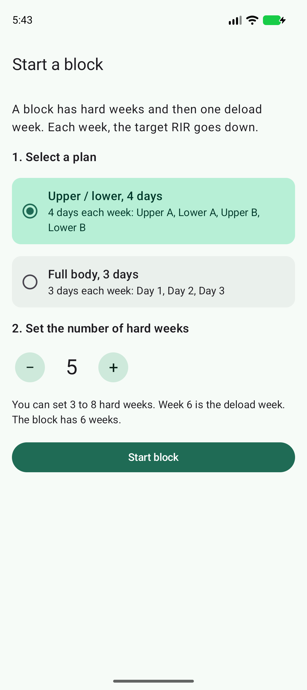
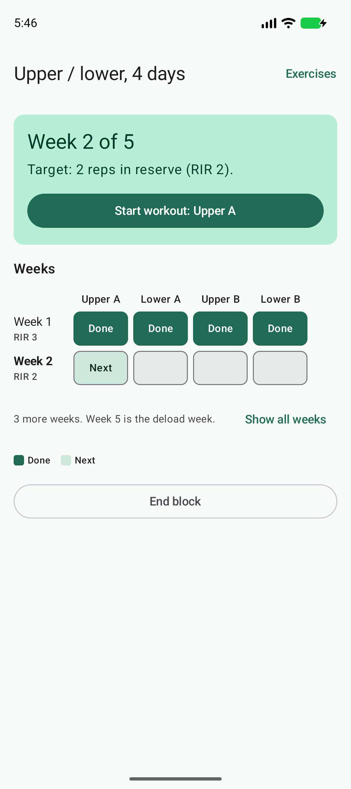
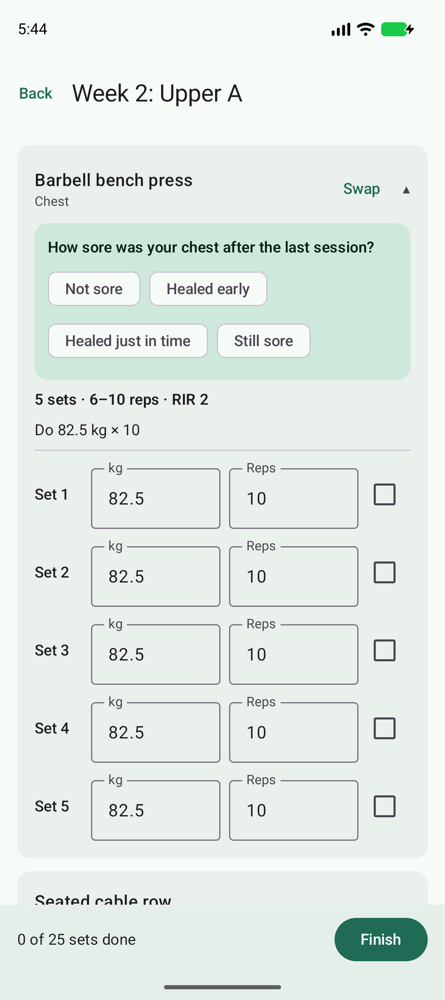
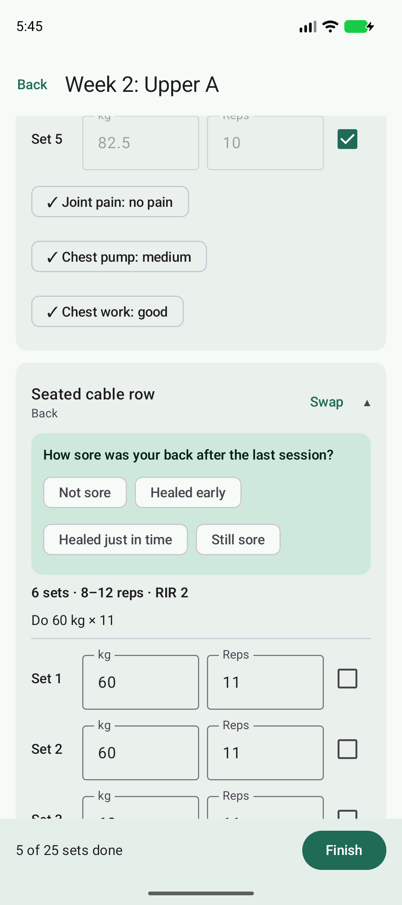
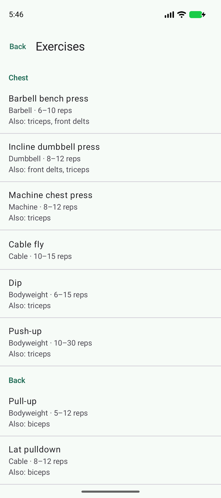

# OpenFitness

OpenFitness is a hypertrophy training app for Android and iOS. It is built with Kotlin Multiplatform.

## Features (planned)

- Training blocks (mesocycles) of 3 to 8 hard weeks, then one deload week.
- Target reps in reserve (RIR) that go down each week, from 3 to 0.
- Feedback for each muscle: soreness, pump, and workload. Feedback for each exercise: joint pain.
- Automatic changes to sets, weight, and reps from that feedback.
- A built-in exercise library and plan templates.

## Modules

- `shared`: Domain model and progression logic. Pure Kotlin, no platform code. Targets: JVM (for tests), Android, iOS.
- `composeApp`: The app UI and workflow, with Compose Multiplatform and Material 3. It is shared by Android and iOS.
  - `data/Workflow.kt`: Start a block, start and finish a workout, roll over to the next week, swap an exercise.
  - `data/AppStore.kt`: Keeps all app data in one JSON file on the device.
  - `ui/`: The screens: start a block, block overview, workout, exercise library.
- `androidApp`: The Android application (`app.openfitness`). It shows the `composeApp` UI.
- `iosApp`: The Xcode project for iOS. It shows the `composeApp` UI.

## Screens

| Start a block | Block overview | Workout | Feedback as chips | Exercise library |
|---|---|---|---|---|
|  |  |  |  |  |

A screen recording of the full flow is in [docs/screenshots/android-walkthrough.mp4](docs/screenshots/android-walkthrough.mp4).

## How the progression works

1. **Week 0.** Each muscle starts at its start volume. Each exercise gets at least 2 sets.
2. **Sets.** After each session, the feedback for each muscle gives a set change:
   - Still sore, or the work was too much: remove 1 set.
   - Recovered on time and the work was not easy: keep the sets.
   - Fast recovery, low pump, or easy work: add 1 or 2 sets.
   - The weekly total for a muscle does not go above its maximum.
3. **Load.** Double progression. Add reps until the top of the rep range, then add one load step.
4. **Joint pain.** Moderate or severe joint pain lowers the weight by about 10%.
5. **Deload.** Half the sets, half the reps, same weight.

## Build and run

You need JDK 17 or later, the Android SDK (API 37), and Xcode for iOS.

Android:

```
./gradlew :androidApp:assembleDebug     # Make the APK
./gradlew :androidApp:installDebug      # Install it on a device or emulator
```

iOS: open `iosApp/iosApp.xcodeproj` in Xcode and run the `iosApp` scheme. A build phase runs Gradle to make the `ComposeApp` framework. From the command line:

```
cd iosApp
xcodebuild -project iosApp.xcodeproj -scheme iosApp -configuration Debug \
  -sdk iphonesimulator -destination 'platform=iOS Simulator,name=iPhone 17 Pro' \
  CODE_SIGNING_ALLOWED=NO build
```

## Run the tests

```
./gradlew :shared:jvmTest                   # Progression logic
./gradlew :composeApp:testAndroidHostTest   # App workflow and storage
```
